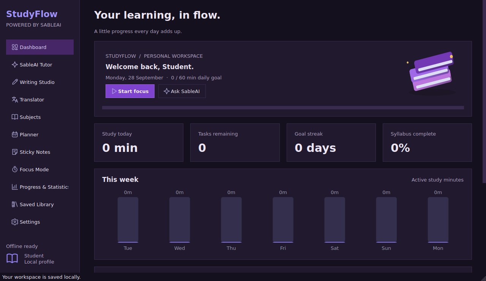

# StudyFlow powered by SableAI

**Your studies, notes and AI assistant — in one desktop workspace.**

StudyFlow brings subject planning, tasks, sticky notes, focused study sessions and progress tracking together. SableAI adds a Gemini-powered tutor, writing studio and translator inside the same application.

Built with **Python · PySide6 · SQLite · Google Gen AI SDK**. The study tools work offline; AI features use your own Gemini API key and an internet connection.



*Application screenshot included with the supplied source; a new profile starts with empty study data.*

[Get started](docs/SETUP.md) · [User guide](docs/USER_GUIDE.md) · [Architecture](docs/ARCHITECTURE.md) · [Contribute](CONTRIBUTING.md) · [GitHub upload guide](docs/GITHUB_SETUP.md)

## What you can do

| Workspace | Features |
| --- | --- |
| Dashboard | Daily study target, task totals, study streak, syllabus progress and deadlines |
| SableAI Tutor | Streaming chat, subject and response controls, conversation history, regenerate and save answers |
| Writing Studio | Essays, applications, letters and paragraphs; outlines, rewriting, shortening and grammar help |
| Translator | Source/target languages, editable output, formatting instructions and saved translations |
| Subjects & Planner | Subjects, chapters, topics, exam marks, deadlines, priorities and completion tracking |
| Sticky Notes | Autosave, tags, colors, pinning, checklist text and floating windows |
| Focus & Progress | Pomodoro, stopwatch, study history, charts and subject statistics |
| Saved Library | Search, filters, favorites, revisions and TXT/DOCX/PDF exports |
| Settings | Light/dark/system themes, primary Urdu interface labels, local profile and backup/restore |

English and Urdu document editing includes RTL support and a bundled Noto Nastaliq Urdu font. Some interface text remains English.

## Quick start — Windows

Use 64-bit **Python 3.11 or newer** with compatible dependency wheels. Extract the entire project, then:

1. Run **`install_windows.bat`** once to install dependencies.
2. Run **`launch_windows.bat`** to open StudyFlow.
3. Create your local profile and start planning.

Or run these commands from the project folder:

```bat
py -3 -m venv .venv
.venv\Scripts\python.exe -m pip install -r requirements.txt
.venv\Scripts\python.exe main.py
```

**Roman Urdu:** ZIP extract karo → `install_windows.bat` chalao → `launch_windows.bat` kholo. API key ke baghair planner, notes aur focus tools use kar sakte ho.

### Enable SableAI

Open **Settings**, paste your Gemini API key, click **Test key / refresh models**, select a text model available to your account, then **Save settings**. No key is included. Model access, limits and usage charges depend on your Google account/project.

Keys stay in memory by default. Optional persistence uses Windows Credential Manager when its native backend is available. The app does **not** read keys from `.env` files.

## Local data and privacy

- SQLite stores your profile, notes, chats, tasks and progress in the application data directory shown in Settings.
- The local database and exported backups are **not encrypted**. Keep them private.
- AI actions send the relevant prompt, conversation or draft to Google. Offline tools need no AI request.
- API keys are kept outside SQLite and backups. See [Security & privacy](SECURITY.md).

## Development

```bat
.venv\Scripts\python.exe -m unittest discover -s tests -v
```

Tests use temporary databases and mocked Gemini responses. See [validation results and limits](VALIDATION.md). A GitHub Actions workflow is included for Windows/Python 3.11 and 3.12; its remote results will only exist after you push the repository.

To build a Windows executable, run `build_windows.bat` on Windows. Distribute the entire `dist\StudyFlow` folder. See [build instructions](docs/DEVELOPMENT.md).

## Project structure

```text
main.py                 Application entry point
studyflow/              UI, SQLite storage, AI workers and exports
assets/                 Icons and licensed Urdu font
tests/                 Offline workflow and mocked AI tests
docs/                   Setup, usage, architecture and publishing guides
.github/                Test workflow and issue/PR templates
StudyFlow.spec          PyInstaller folder-build configuration
requirements.txt        Runtime dependency ranges
```

## Current scope

Version **1.0.0** is a local, single-student desktop workspace. Cloud synchronization, account authentication, collaboration and payments are not implemented. Local profile setup is not a password-protected login. Live Gemini calls and Windows packaging require separate real-device verification; no working API account or downloadable EXE is bundled.

## Licensing and credits

An application source-code license has not been selected. This package does not add an open-source reuse grant; see [LICENSE.md](LICENSE.md). The bundled font retains its own SIL Open Font License. See [third-party notices](THIRD_PARTY_NOTICES.md).
